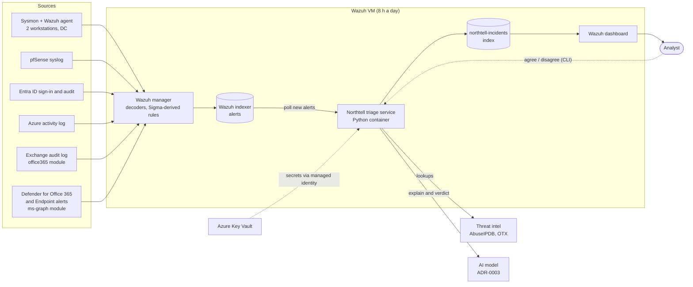
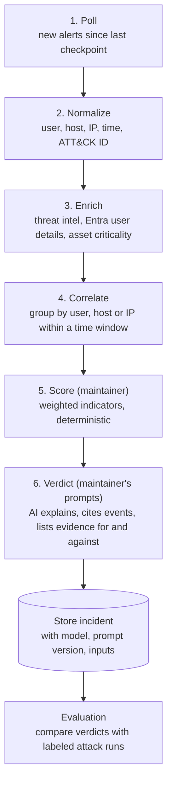

# Northtell v1 design

> Status: final design for v1, 2026-11-03. Decisions still open are listed in section 17.
> Where this document differs from the charter or ADR-0002, this document applies; section 19 lists the edits to make there.

## 1. Intent
Northtell is a SIEM that tracks the attack path, enriches events, explains what happened, and separates true positives from false positives. It is built from scratch as a product: designed, built, secured and operated end to end, and presented like a product demo.

The charter's AI layer groups alerts and explains them. This design widens it: the AI layer also gives a verdict on each incident.

## 2. Scope

**In v1**
- Wazuh as the SIEM, fed by endpoint, firewall, identity, cloud, mail and Microsoft Defender sources (section 6).
- The Northtell triage service: correlation, enrichment, deterministic scoring and an AI verdict for every incident (sections 8 and 9).
- Nine attack scenarios, each simulated in the lab and detected by tested rules (section 4).
- A thin slice of threat intel and GRC (section 11).
- All infrastructure in Terraform, deployed through a secured GitHub pipeline (section 13).
- The README as the public demo viewer (section 12).

**Not in v1**
- C2 beaconing (T1071) and prompt injection against the AI layer: v1.1.
- Velociraptor for live forensics: v1.1.
- Discovery, privilege escalation, exfiltration and Azure tampering scenarios: later.
- The Northtell Console (Phase 4.5) and a hosted public demo page.
- Automated response actions, multi-tenant use, and real personal or production data (charter).

## 3. Constraints and milestones
- Budget: 100 CAD a month through November 2026, 250 CAD a month from December, with a kill switch at 90% (225 CAD). How usage is counted is in section 15.
- One maintainer, part-time.
- Lab footprint from ADR-0002: Wazuh all-in-one, 2 Windows workstations, 1 domain controller, 1 pfSense, 1 Kali attacker, in Azure Canada Central.
- Entra ID is on the Free tier today. Sign-in log export needs P1 or P2, so ingesting Entra ID sign-ins (charter objective O1) depends on the licensing decision.

| Milestone | Content |
|---|---|
| November 2026: Phase 0 | Docs, Terraform remote state, the pipeline and repository controls. No lab is deployed while the cap is 100 CAD. |
| December 2026 | First lab deployment. |
| End of January 2027: first demo | Lab running, Wazuh ingesting, detections firing, and the phishing chain shown end to end with a measured AI verdict that clears the 85% gate (section 10). |
| After January | The other eight scenarios are measured against the gate one by one. |

## 4. Attack scenarios

**Headline scenario: phishing to account compromise**
1. A test user receives a phishing email and Defender for Office 365 raises an alert. On its own this is low confidence.
2. The user opens the link and enters credentials. Sysmon and pfSense show the workstation reaching the page.
3. The same account signs in from a new IP and device, seen in the Entra ID sign-in logs.
4. Northtell joins steps 1 to 3 into one incident with one timeline, gives a true positive verdict, and maps each step to ATT&CK.

A link alert with no click and no unusual sign-in scores low. The full chain on the same user within a short window scores high, and the AI explains how the events connect.

The phishing email and credential page come from Microsoft's Attack Simulation Training, which hosts both inside the tenant, so no attacker-run landing page is needed. Attack Simulation Training depends on licensing option A (section 16).

**v1 scenarios**

| Stage | Scenarios | Example ATT&CK |
|---|---|---|
| Initial access | Phishing, password spray | T1566, T1078, T1110.003 |
| Credentials | Credential theft from LSASS | T1003.001 |
| Execution | Remote code execution on a web-facing target | T1190 |
| Persistence | Scheduled tasks, services, Run keys; Entra role or app-consent persistence | T1053, T1543, T1547, T1098, T1528 |
| Movement | Lateral movement over RDP, SMB or WinRM | T1021 |
| Evasion | Stopping Sysmon, the Wazuh agent or Defender; clearing event logs | T1562.001, T1070.001 |
| Impact | Ransomware-like activity on a test folder | T1490, T1486 |

- With 2 workstations, lateral movement runs workstation to workstation or workstation to the domain controller.
- The RCE scenario needs a web-facing target, which the v1 lab lacks (section 17).
- Build order: phishing, then credential theft, then lateral movement, then ransomware, so a demoable chain exists early. The other scenarios fill in around it.
- Simulation: Atomic Red Team and MITRE Caldera, run only in the lab against Northtell's own tenant and test users, plus Attack Simulation Training for phishing. Each run is logged with its scenario, run ID, start and end time, so it becomes a labeled example for evaluation.

## 5. Identity
- Test users are created in Active Directory on the domain controller and synced to Entra ID with Entra Cloud Sync, so one person has one identity across mail, workstation and cloud sign-in.
- Workstations are joined to the domain and onboarded to Defender for Endpoint.
- Correlation matches people by UPN.
- To verify during the build: whether hybrid-joining the workstations to Entra ID needs Entra Connect Sync instead of Cloud Sync.

## 6. Log sources
| Source | Path into Wazuh | Needs |
|---|---|---|
| Sysmon on workstations and DC | Wazuh agent | |
| pfSense | Syslog | |
| Azure activity log | Wazuh Azure module | |
| Entra ID sign-in and audit logs | Wazuh Azure or Graph module | Entra ID P1 or P2 |
| Exchange Online unified audit log | Wazuh `office365` module (Office 365 Management Activity API) | Exchange Online licenses |
| Defender for Office 365 alerts, Safe Links clicks | Wazuh `ms-graph` module (Graph security API) | Defender for Office 365 |
| Defender for Endpoint alerts | Wazuh `ms-graph` module | Defender for Endpoint |

Streaming raw Defender for Endpoint telemetry is out of scope: it needs Event Hub, costs money, and duplicates Sysmon.

## 7. Detections and endpoint stack
- Start from SigmaHQ rules and select 15 to 30 that cover the scenarios.
- A pySigma processing pipeline maps Sigma field names to Wazuh field names, for example `Image` to `data.win.eventdata.image`.
- Each rule ships with its ATT&CK ID, the test that triggers it, evidence of the alert it produced, and tuning notes.
- Custom correlation rules cover chains that cross sources (mail, endpoint, identity).
- The conversion path is decided in its own ADR before detection work starts (section 17).

| Layer | Tool | Role |
|---|---|---|
| Telemetry | Sysmon and the Wazuh agent | Raw endpoint events |
| Detection | Sigma-derived rules in Wazuh | The detections Northtell builds |
| Second opinion | Microsoft Defender for Endpoint | Agreement or disagreement with Northtell's rules feeds scoring and shows coverage gaps |

Defender for Endpoint runs in passive (audit) mode during measured attack runs, so it reports the LSASS theft, ransomware, Defender tampering and log clearing instead of blocking them before Northtell's rules see them. One demo run uses blocking mode to show prevention.

## 8. Architecture

All components run inside the lab's Azure networks. Wazuh collects and detects. A separate Python service, the Northtell triage service, turns alerts into scored, explained incidents.



Each batch of alerts goes through six steps. The maintainer writes the scoring step, the prompts and the metric definitions by hand.



| Decision | Choice | Why |
|---|---|---|
| How alerts reach the triage service | Poll the Wazuh indexer every 60 seconds from a saved checkpoint. Raw alerts reach the dashboard at once; incidents follow within about a minute and keep updating as related alerts arrive | Batches alerts for correlation, replays a time range, and loses nothing on restart |
| Where the triage service runs | A container on the Wazuh VM, sized B4as_v2 (4 vCPU, 16 GiB). It moves to its own small VM if memory gets tight | About 19 CAD a month more than the 8 GiB size, and it shares Wazuh's schedule and subscription |
| Where incidents are stored | A `northtell-incidents` index in the Wazuh indexer, behind one storage module so a later move to PostgreSQL touches only that module | No extra database; the dashboard shows the index directly |
| What the analyst uses | Saved Wazuh dashboard views over the incidents index, and a small CLI to agree or disagree with a verdict | Keeps v1 inside the charter |
| Secrets | Azure Key Vault, read through the Wazuh VM's managed identity, defined in Terraform | No secrets on disk or in the repo; access is revoked in one place |
| AI model and external API | ADR-0003 (section 17) | Cost, data exposure and realism |

Security properties:
- The triage service's indexer account reads alerts and writes only to `northtell-incidents`.
- The triage container's outbound traffic is limited to the threat intel feeds, the model endpoint and the Azure endpoints it needs (Key Vault, managed identity). The rest of the lab reaches the internet through pfSense with an allowlist that includes the Microsoft endpoints that Wazuh's cloud modules, Defender and Entra sign-ins need. Enforcement uses network security groups and pfSense rules; Azure Firewall is beyond the budget.
- The single static public IP sits on the pfSense WAN interface. Admin access is a WireGuard or OpenVPN tunnel on pfSense. The Wazuh dashboard, the VMs and the triage service have no public IPs.
- Log fields go into prompts as quoted data, never as instructions, which prepares for the v1.1 prompt-injection work.
- Every verdict records the model, prompt version and exact inputs, so any decision can be audited.

## 9. AI verdict design
- Four verdicts: true positive, benign true positive (real but expected activity, such as admin maintenance), false positive, and undetermined, which goes to a human.
- Every reason cites the event behind it, and the verdict lists evidence against as well as for.
- The score comes from deterministic weighted indicators: chain completeness, Defender for Endpoint agreement, asset criticality, and prior behaviour of the user or host. The model explains the score; it does not produce it.
- Accuracy is measured against ground truth: every simulated attack run is a labeled true positive and matching benign activity is labeled benign. The repo reports how often verdicts are right in each score band.
- The AI never closes an incident. The analyst agrees or disagrees through the CLI, and that feedback is stored for tuning.

Example incident record:

```
INC-0142  Phishing to account compromise        Verdict: TRUE POSITIVE
Score: 88/100 (rules)   Verdict accuracy at this score in the lab: [measured]
For:
  + Defender for Office 365 flagged link to user jdoe            [MDO alert]
  + WS-01 reached the same domain 3 min later                     [pfSense, Sysmon 22]
  + jdoe signed in from an IP never seen before, 4 min later      [Entra sign-in]
  + Defender for Endpoint raised a related alert                  [MDE alert]
Against:
  - Sign-in passed MFA (could be a legitimate user on a new network)
ATT&CK: T1566.002, T1204.001, T1078
Next step: revoke jdoe sessions; check browser history on WS-01
Model: <ADR-0003>  Prompt v3  Inputs: 14 events
```

## 10. Detection and verdict quality gates
- Every detection rule has an offline test: stored sample events run through `wazuh-logtest` in CI, so a broken rule fails its PR before it reaches the lab.
- A pre-demo smoke test runs each demo scenario's simulation in the lab and checks that the expected alert and incident appear.
- A scenario is shown in a demo only after its verdict accuracy is measured: at least 85% correct, with 90% as the target, over at least 20 labeled attack runs (85% means 17 of 20), plus matching benign runs so the false positive rate is measured too. An undetermined verdict on an attack run counts as not correct and is reported separately.
- The evaluation harness (run log, labeling alerts by run, comparing stored verdicts with labels) is built alongside the triage service, against stub scoring and prompt interfaces until the maintainer's versions exist. The maintainer defines the metrics.
- The model and prompt version are pinned for demos, with deterministic settings where the model allows them.
- Replay mode: because the triage service polls from a checkpoint, a recorded attack's alerts can be replayed and give the same incident every time.
- A recorded demo video is the fallback if the live lab misbehaves.

## 11. Threat intel and GRC in v1
- One or two free threat intel feeds (AbuseIPDB, AlienVault OTX) enrich incidents during step 3.
- One control-mapping document maps the platform to NIST CSF 2.0 or the CIS Controls, and the AI layer to the NIST AI RMF or ISO/IEC 42001.
- Deeper threat intel (MISP or OpenCTI, STIX/TAXII) and GRC work go to v1.1.

## 12. Public demo viewer
The README is the front door. It opens with a two-line pitch, then a 3-minute demo video of the phishing chain playing inline, the measured verdict accuracy, and a "Capabilities and where to see them" table linking each capability to its evidence in the repo: ADRs, tested detections, CI security gates, PR history, incident log, cost tracking and evaluation results.
- The video is attached through GitHub's editor so it plays on the repo page. A free GitHub plan allows 10 MB per video, so the recording is a compressed 720p screen capture.
- A full-quality copy goes on YouTube and is linked under the inline player.
- The video file is never committed to git.

## 13. Contribution, pipeline and repository security

**Contribution and AI-assisted development policy**
- AI coding agents may write code, but every change arrives as a pull request and must pass every required CI check before it can merge.
- AI-assisted commits are made under the maintainer's account, signed with the maintainer's key, and carry a `Co-Authored-By` trailer naming the agent. A separate GitHub App identity for agents may follow later.
- GitHub Actions cannot approve pull requests, so no automated identity can approve its own change.
- The maintainer writes the scoring rules, the prompts and the metric definitions, and reviews every other change.
- Repository and Azure security settings are changed only by the maintainer, and each change is recorded in `docs/`.
- Architecture choices are recorded as ADRs.

**Repository controls in place**
- Ruleset on `main`: pull request required, signed commits, squash merges only, linear history, no deletions, no force-pushes, no bypass.
- Secret scanning with push protection.
- Dependabot alerts and security updates.
- Read-only default `GITHUB_TOKEN`.
- GitHub Actions cannot approve pull requests.

`docs/03-repository-security.md` lists each control once it is enforced and verified.

**Setup order**
1. Narrow allowed actions and turn on SHA pinning.
2. Add `dependabot.yml` for pip and GitHub Actions, and a gitleaks pre-commit hook.
3. Write the first CI workflow with least-privilege permissions and make it a required status check.
4. Add IaC and detection gates: `terraform fmt` and `validate`, tflint, checkov, Sigma lint, `wazuh-logtest` rule tests.
5. Set up OIDC from GitHub to Azure with a protected `production` environment: `plan` on each PR, `apply` only after approval.
6. Add CodeQL and Bandit for Python.
7. Add CODEOWNERS on the maintainer-written paths.

## 14. Terraform layout
- **`platform` stack:** identities, role assignments, Key Vault access, budgets and the kill switch. The maintainer applies it from the workstation.
- **`lab` stack:** networks, VMs, disks and the triage service. The pipeline applies it after the maintainer approves the `production` environment.
- The pipeline's identity has Contributor on the lab resource groups only and cannot grant roles.

## 15. Lab, subscriptions and cost

**Runtime schedule:** the whole lab, Wazuh included, runs 8 hours a day, every day.

**Subscription split**, with licensing option A: Wazuh and its disk stay in the current pay-as-you-go subscription. The lab VMs (workstations, domain controller, pfSense with the public IP, Kali) go in the Visual Studio subscription, connected to the Wazuh network by VNet peering. When the US$50 monthly credit runs out (around day 18), the maintainer lifts the spending limit for that billing period so the lab keeps running, and the card covers the rest (about 30 to 45 CAD). If the limit were left on, only the lab VMs would stop; Wazuh would keep running.

**Budget and kill switch**
- The 250 CAD cap and the 225 CAD kill switch count all Azure usage at retail price across both subscriptions, including the part the credit pays and Marketplace fees. License costs are a separate yearly cost outside the cap.
- Azure budgets are per subscription, so each subscription gets its own budget and alerts, and a small scheduled job sums both for the kill switch.
- At 225 CAD the kill switch deallocates every VM in both subscriptions, Wazuh included, and alerts the maintainer. Disks and the IP keep billing.

**Cost**, from the Azure retail price list, Canada Central, 2026-11-03 (Linux unless noted, about 243 hours a month):

| Item | Size | CAD/month |
|---|---|---|
| Wazuh and triage service | B4as_v2, 4 vCPU, 16 GiB | 57 |
| 2 workstations | B2s, Windows | 37 |
| Domain controller | B2s, Windows | 19 |
| Kali | B2s | 16 |
| pfSense | B1ms; Marketplace software fee not priced | 8 |
| Disks, billed even while VMs are off | Wazuh 256 GB Standard SSD (30); lab on Standard HDD (34) | 64 |
| Static public IP on pfSense WAN, billed all month | 1 | 5 |
| Total | | about 206, plus egress and peering |

About 87 CAD falls on pay-as-you-go and about 119 CAD (about US$85) on the Visual Studio subscription, where the credit pays about 70 CAD. The kill switch fires at 225 CAD, leaving about 19 CAD of headroom, so egress, peering and the pfSense fee are measured in the first month. Running Wazuh around the clock would cost about 320 CAD, over the cap.

**Effects of the schedule**
- Endpoints and pfSense are off whenever Wazuh is off, so nothing is lost from them.
- Cloud sources are pulled from APIs. Wazuh's modules are expected to catch up from a checkpoint on start; this is tested early. Catch-up is bounded by API retention, for example 7 days of Entra sign-in logs on the Free tier and 30 days with P1 or P2.
- Cloud alerts are detected when Wazuh next starts. The README calls this scheduled collection with catch-up.
- Demos outside the schedule need a manual start.
- B-series VMs are burstable. If the Wazuh indexer keeps the CPU busy, the VM may be throttled; this is measured in the first weeks.

## 16. Licensing options

**Option A: Visual Studio Professional standard subscription.** Monthly VS subscriptions do not qualify.
- Includes a Microsoft 365 E5 developer sandbox with 25 licenses: Entra ID P2, Exchange Online, Defender for Office 365 P2 with Attack Simulation Training, and Defender for Endpoint P2.
- Includes a renewable US$50 a month Azure Dev/Test credit in its own Visual Studio Azure subscription, for dev/test use, with a spending limit.
- Costs US$99.99 a month billed as a full year (about US$1,200 in year 1), renewing at US$66.59 a month (about US$799 a year). US list prices; CAD to be checked.
- The sandbox is a separate tenant and renews only while the VS subscription is active.
- Sources: learn.microsoft.com/en-us/visualstudio/subscriptions/vs-azure-eligibility and learn.microsoft.com/en-us/office/developer-program/join-with-visual-studio.

**Option B: licenses bought one by one.** US list prices per user per month: Exchange Online P1 $4, Defender for Office 365 P1 $2 (P2 $5), Entra ID P2 $10, Defender for Business about $3. For 2 target users, about $32 to $38 a month before endpoint licensing. No Azure credit, so the subscription split does not apply, and Attack Simulation Training needs Defender for Office 365 P2.

**Option C: 30-day trials** of E5 and Entra ID P2. Enough to record a demo, not to run the lab.

## 17. Open decisions
| Decision | Options | Blocks |
|---|---|---|
| Licensing | A, B or C (section 16) | Mail and Defender sources, Entra ID sign-ins, Attack Simulation Training, the subscription split |
| AI model and external API (ADR-0003) | External model API, or Azure-only | The verdict step, its cost and data exposure |
| RCE target | A deliberately vulnerable web app on one workstation, or a sixth small VM | The RCE scenario |
| Tenant and subscription layout (ADR) | One Entra tenant for both subscriptions; whether the Azure subscriptions move into the E5 sandbox tenant | Terraform layout and identity sync, with option A |
| Sigma conversion path (ADR) | `pySigma-backend-opensearch` or Wazuh XML rules | Detection work |

## 18. Implementation details not fixed here
- Python project layout, libraries and test framework inside `ai-triage/`.
- Index mappings for `northtell-incidents`, the checkpoint format, and the CLI's commands.
- Terraform module structure inside `infra/`, within section 14.
- The correlation time windows and indicator weights, as starting values that the maintainer tunes.
- Which SigmaHQ rules to start from, within the scenario list.

## 19. Edits to the charter and ADR-0002
- Charter: log sources grow from 4 to 7 (section 6); the AI layer adds verdicts; Entra ID P2 may come from E5 instead of 5 purchased licenses; the lab footprint follows ADR-0002; sigma-cli and pySigma join the toolchain.
- ADR-0002: Wazuh runs 8 hours a day on B4as_v2, not 24/7 on B4als_v2; the cost estimate is replaced by section 15 (the ADR's estimate put Wazuh at about US$61 a month 24/7, but B4als_v2 costs about US$108 a month at that runtime); the subscription split and the 8-hour schedule are added.
